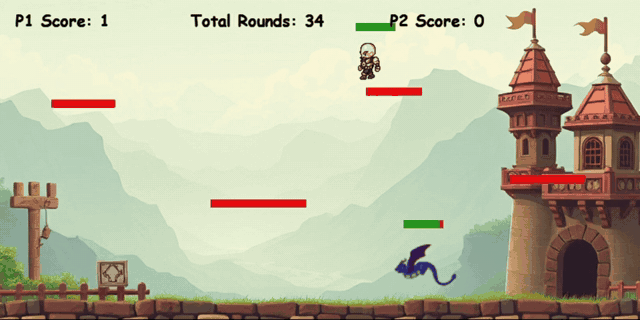

# Trial By Combat

A two-player, same-screen fighting game built with Python and Pygame. A knight and a dragon battle across a castle landscape, jumping between platforms and firing projectiles until one runs out of health.



## Features

- Local two-player gameplay on a single keyboard
- Projectile attacks with a short cooldown between shots
- Independent health tracking and on-screen health bars for each character
- Jumping, gravity and four platforms to fight across
- Round-based scoring, with each player's score shown on screen
- Total rounds played is stored in an SQLite database, so it persists between sessions

## Getting started

**Requirements:** Python 3 and Pygame (`sqlite3` is included with Python).

```bash
git clone https://github.com/WM442/[repo-name].git
cd [repo-name]
pip install pygame
python main.py
```

The sprite images and `bg4.jpg` must stay in the same folder as `main.py`. The game creates its database file (`game_data.db`) automatically on first run.

## Controls

| Action | Player 1 (Knight) | Player 2 (Dragon) |
|--------|-------------------|-------------------|
| Move left / right | `A` / `D` | `←` / `→` |
| Jump | `W` | `↑` |
| Shoot | `Space` | `End` |

## How it plays

Each player starts a round with 10 health, and every projectile hit removes one point. When a player's health runs out, the other player scores a point, both characters reset to their starting positions, and the total rounds counter goes up by one.

## How it works

The game is a single script built around three classes:

- **`Player`** holds everything for one character: position, movement, jumping, gravity, animation frames, hitbox, health and score. Both characters are instances of the same class, so each one tracks its own health separately.
- **`Projectile`** handles a shot's movement and remembers who fired it, so a player can't hurt themselves.
- **`Platform`** defines the rectangles characters can stand on.

The main loop checks each projectile against each player's hitbox, applies damage, moves characters, applies gravity and redraws the screen at 27 frames per second. Round totals are saved with Python's built-in `sqlite3` module.

## What I learned

The hardest part of the project was the health system, because each character needed its own health tracked separately and linked to what the player sees on screen. I solved it by breaking the problem into smaller parts: a general character class holds each character's health, and the health bar is drawn from that data and updated when a projectile hits. It taught me to isolate a problem before trying to fix it, and to test as I build so small issues don't pile up.

It was also my first time using a database inside a game. Storing the total rounds played in SQLite showed me how to keep data between sessions rather than losing it when the program closes.

## Project structure

```
├── main.py            # Game code: Player, Projectile and Platform classes, plus the main loop
├── bg4.jpg            # Background image
├── R1.png ... R9.png  # Walking animation frames (facing right)
├── L1.png ... L9.png  # Walking animation frames (facing left)
├── standing.png       # Idle sprite
├── L1A3.png ...       # Dragon sprites
└── screenshots/       # Images used in this README
```

## Possible improvements

- Size each character's hitbox to match its sprite, rather than sharing one set of values
- Split the code into separate modules (players, projectiles, database) instead of one file
- Add a single-player mode against a computer-controlled opponent
- Add sound effects, a start menu and a winner screen
- Store per-player win history in the database, not just the total rounds
